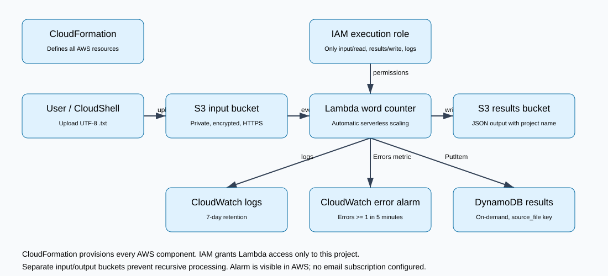
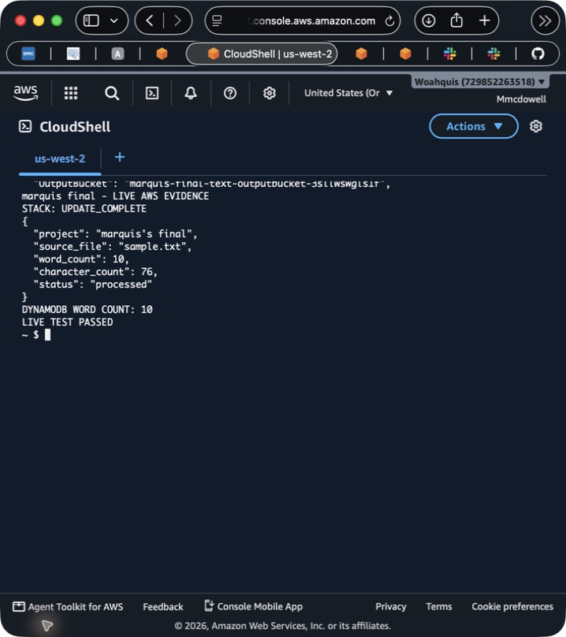

# marquis's final — AWS serverless text pipeline

Upload a UTF-8 text file and automatically receive a word-count summary in S3 and a searchable result in DynamoDB. Built for small teams processing occasional text documents without keeping a server running.

**Verified on AWS:** the sample upload produced **10 words, 76 characters**, and the label **marquis's final** in both result stores. CloudFormation reached `UPDATE_COMPLETE`; CloudWatch recorded a successful Lambda invocation and the error alarm was `OK`.



## Architecture decisions

- **S3 input and output buckets:** private, encrypted object storage; separate buckets prevent a recursive upload trigger.
- **Lambda and serverless scaling:** short event-driven processing instead of an idle EC2 instance or container service.
- **DynamoDB on-demand:** lookup by source filename without the overhead of a relational database.
- **CloudWatch logs and alarm:** seven-day logs and an alarm when Lambda Errors >= 1 in five minutes. The alarm has no email/SNS action.
- **IAM and CloudFormation:** temporary execution-role credentials, scoped permissions, and repeatable infrastructure. Bucket policies require HTTPS.

## Evidence and report

[Read the PDF report](Marquis-Final-Report.pdf) · [Cost estimate](COST.md) · [Implementation challenges](CHALLENGES.md)



Additional screenshots: [resources](evidence/deployed-resources.png), [execution logs](evidence/cloudwatch-logs.png), [alarm](evidence/alarm.png), and [Pricing Calculator](evidence/pricing-calculator.png).

## Reproduce

Use AWS CloudShell or an authenticated AWS CLI with permission to create this stack. Clone/download this repository, then run commands from its root. Python 3 is needed for verification; Lambda includes the AWS SDK. No access keys are stored here.

```bash
# Check the application logic locally; these tests mock AWS services.
python3 -m unittest discover -s tests

# Validate and deploy all infrastructure in us-west-2.
bash deploy.sh

# Upload sample.txt, assert the S3 and DynamoDB results, and show logs.
bash test-live.sh
```

Optional overrides: `AWS_REGION` (default `us-west-2`) and `STACK_NAME` (default `marquis-final-text`). The infrastructure template embeds `src/index.py`; update both the source and embedded code when changing the function. CloudFormation outputs supply the generated bucket/table names.

Upload a `.txt` file of at most 1 MiB. Words are whitespace-separated tokens; characters are Python Unicode characters including whitespace. Results use the key `<source filename>.json`. The project label is the template's `ProjectName` parameter.

## Security, reliability, and limits

Both S3 buckets block public access and require TLS. Lambda reads only input objects, writes only output objects and this DynamoDB table, and writes its logs. There are no SSH ports or security groups in this design.

This is a single-region demonstration, not a production DR system. There is no dead-letter queue, cross-region backup, input versioning, or atomic transaction across S3 and DynamoDB. Duplicate unchanged inputs overwrite the same keys. Reusing a filename while events are processing can cause version races. Failure handling, load, AZ failover, alarm transitions, and the proposed 30-minute recovery target have not been tested.

## Cost and cleanup

The saved [AWS Pricing Calculator estimate](https://calculator.aws/#/estimate?id=bb2a75426d33c8a78f4bf4e89be9b60eb51b9e7e) displays **$0.14/month** for the small modeled workload; see COST.md for assumptions and exclusions. This is an estimate, not actual billing.

After capturing evidence, run:

```bash
bash cleanup.sh
```

The script asks you to type `DELETE`, empties the two project buckets, deletes this stack, waits, and prints the final status. It does not target other coursework resources.

**Demonstration cleanup status:** verified `DELETE_COMPLETE` on October 25, 2026 at 11:50 PM Pacific. All ten stack resources were deleted after evidence capture. See [cleanup evidence](evidence/cleanup.png) and [details](evidence/cleanup-status.txt).

## Project files

- `architecture/`: editable draw.io and SVG diagram, committed before deployment
- `src/index.py`: Lambda handler
- `template.json`: complete CloudFormation stack
- `tests/`: local behavior tests
- `evidence/`: screenshots and verified result transcription
- `deploy.sh`, `test-live.sh`, `cleanup.sh`: reproducible workflow

Prepared with assisted tooling. Service choices, limitations, and recovery assumptions are documented for review and interview discussion.
